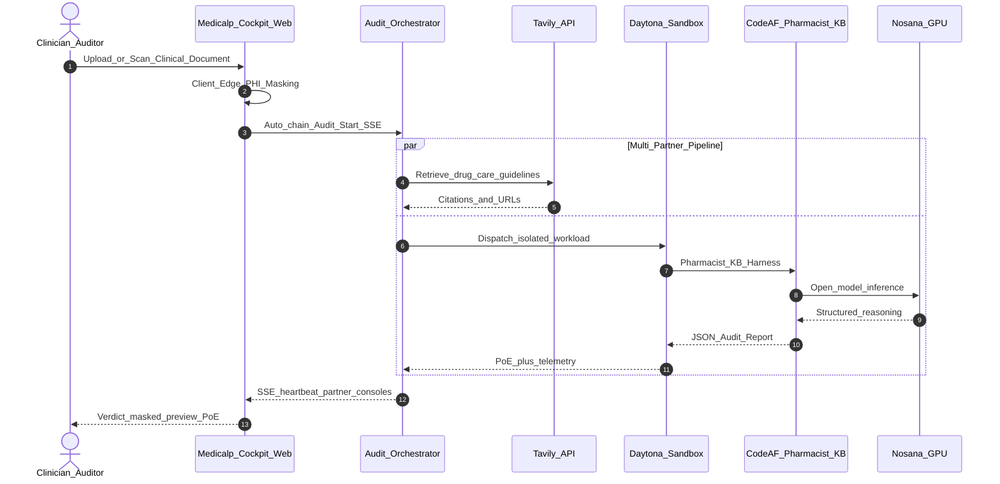

# Medicalp Cockpit — Autonomous Clinical & Care-Audit AI Agent

> **Built for Tokyo AgentForge Hackathon (Nov 14, 2026)**  
> Autonomous multi-agent clinical & long-term care audit cockpit with client-side PHI masking, real-time SSE telemetry, and verifiable multi-partner execution.

## Live Demo / Deployment

- **Production (CloudFront):** https://dgcdk3euel458.cloudfront.net/
- Judges: open the URL for Technical Execution (Criterion 3). No login required for the demo surface.

---

## Problem & Real-World Impact

Medical and long-term care facilities in Japan face massive administrative burdens auditing care plans, medication records (Form 2 / 処方・介護記録), and compliance documents—while strict privacy regulations prohibit sending raw Protected Health Information (PHI) to external clouds.

**Medicalp Cockpit** solves this end-to-end:

1. **Zero-Trust PHI Masking**: Automatically detects and masks patient identifiers on uploaded/scanned clinical documents (letterbox & coordinate-aware redaction) before downstream LLM processing.
2. **Scan-to-Audit Auto-Chain**: Drop or scan a clinical form to trigger an immediate, real-time Server-Sent Events (SSE) multi-agent audit pipeline with live partner telemetry consoles.
3. **Verifiable Multi-Agent Care Audit**: Cross-checks prescriptions, contraindications, and regulatory care requirements using four specialized partner technologies in a single unified workflow.

---

## Partner Technologies Used (Code-Level Integration)

We deeply integrated **all 4 event partner technologies** into our core runtime and UI telemetry consoles:

### 1. CodeAF by AgentField AI (`Pharmacist KB Subharness`)

- **Role**: Specialized **Pharmacist Knowledge-Base Harness** and multi-step verification engine (`planner` / `worker` / `checker`).
- **Integration**: Headless CodeAF execution and structured specialist subharness logic to audit medication regimens, dosage rules, and care-plan consistency.
- **Code**: `apps/api/src/partners/codeaf.ts`

### 2. Daytona (`Isolated Sandbox & Proof of Execution - PoE`)

- **Role**: Secure, isolated sandboxes for audit scripts and cryptographic **Proof of Execution (PoE)** receipts.
- **Integration**: Spins up Daytona workspaces via API/SDK, runs verification harnesses in isolation, streams execution logs / exit codes / PoE artifacts into the Partner Console.
- **Code**: `apps/api/src/partners/daytona.ts`

### 3. Tavily (`Live Clinical & Regulatory Evidence Retrieval`)

- **Role**: Real-time web & medical guideline retrieval for drug interactions, PMDA/MHLW notices, and clinical evidence.
- **Integration**: Tavily Search & Extract APIs during the audit loop to ground findings in external citations.
- **Code**: `apps/api/src/partners/tavily.ts`

### 4. Nosana (`Decentralized GPU Open-Model Inference`)

- **Role**: High-throughput open-model GPU inference endpoint.
- **Integration**: Routes anonymized clinical text / agent reasoning to OpenAI-compatible open-weight models on Nosana GPU nodes.
- **Code**: `apps/api/src/partners/nosana-llm.ts`, `apps/api/src/partners/nosana-vision.ts`

### PHI / UI surfaces

- `apps/web/src/lib/components/MaskPreview.svelte`
- `apps/web/src/lib/components/SectionConsoleBox.svelte`
- `apps/web/src/lib/components/PartnerStatusDock.svelte`
- `apps/web/src/lib/components/AgentConsoleLog.svelte`

Env template: `env.example`

---

## System Architecture



---

## Key Features

- **ScanUploader & Auto-Chain Pipeline**: One-click document scan/drop with Form 2 clinical datasets and instant audit chaining.
- **PHI Masking Engine**: Letterbox-aware visual redaction with clear/reset controls.
- **Realtime Partner Section Consoles**: Live SSE telemetry for CodeAF, Daytona (LIVE PoE), Tavily, and Nosana.
- **Bilingual UI (i18n)**: Japanese / English switching for clinical operators and international judges.

---

## Quick Start

```bash
cp env.example .env
# Set TAVILY_API_KEY, DAYTONA_API_KEY, NOSANA_VISION_URL / NOSANA_API_KEY, CODEAF_* as needed
pnpm install --ignore-scripts
pnpm --filter @care-audit/api start:dev   # :3001
pnpm --filter @care-audit/web dev         # :5173 proxies /api
```

Acceptance suite:

```bash
pnpm --filter @care-audit/api test:acceptance
```

---

## Team

Riu Tokiwa — Co-Founder, Representative Director & CTO at Aezisai Inc.
