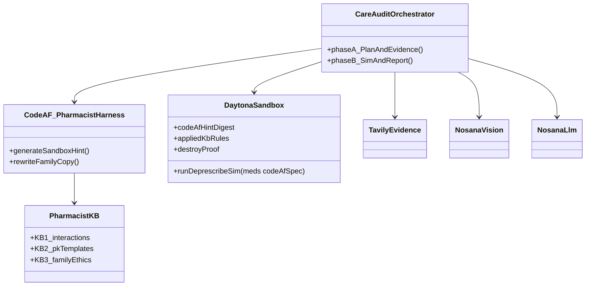
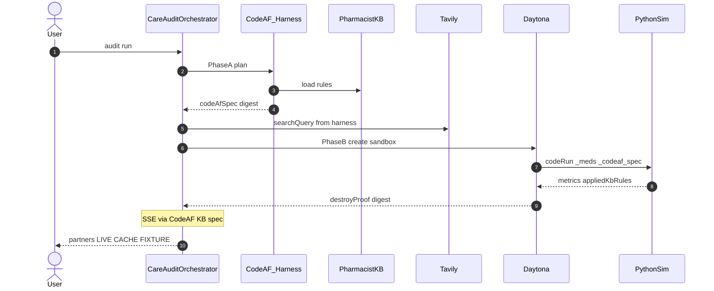
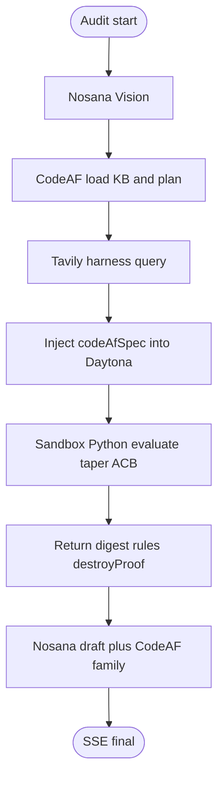

# CodeAF Pharmacist Harness + Daytona Proof of Execution

report_kind: design
stream: 1118-codeaf-pharmacist-harness
plan_review_status: PASS
INDEX_FALLBACK: true
index_paths_read: .cortex-hippocampus/experience/rules/INDEX.md

## 判定

As-Is の並列 1-shot は LIVE 証跡デモには足りるが CodeAF スポンサー審査は弱い。To-Be では CodeAF を薬剤師 KB ハーネス（Control Plane）、Daytona を決定論的サンドボックス（Data Plane）とし、codeAfSpec 注入で metrics を実際に変動させ digest / appliedKbRules / destroyProof で動作立証する。

## Class

## Sequence

## Activity

## Daytona x CodeAF 境界立証

- Control Plane: CodeAF + Pharmacist KB が構造化 codeAfSpec を生成。
- Data Plane: Daytona が _codeaf_spec を Python に json.loads 注入し計算。LLM 暗算禁止。
- 立証: 同一 meds で taper 変更 → metrics 変化 + codeAfHintDigest 一致 + SSE via CodeAF KB spec。
- 53MB CodeAF バイナリは持ち込まない。
